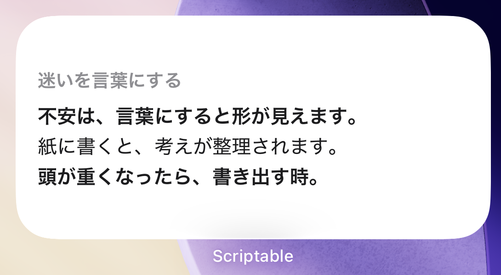

# scriptable-widgets

iPhone のホーム画面に置ける [Scriptable](https://scriptable.app/) 用のウィジェットを集めたリポジトリです。

## ウィジェット一覧

| 名前 | 内容 | フォルダ |
| --- | --- | --- |
| 格言ウィジェット | Obsidian の Kanban ボードの「Active」列から、格言を1件ランダムに表示する | [kakugen-widget/](kakugen-widget/) |




## 使い方（格言ウィジェット）

1. Scriptable に `格言.js` を作る。中身は次のコマンドでコピーできます（Mac のターミナルで実行）。

   ```bash
   cp kakugen-widget/kakugen-widget.js "$HOME/Library/Mobile Documents/iCloud~dk~simonbs~Scriptable/Documents/格言.js"
   ```

2. 詳しいセットアップ（Vault の登録、ボードの書き方、設定ファイル）は [kakugen-widget/README.md](kakugen-widget/README.md) を見てください。

## ライセンス

[MIT License](LICENSE)
