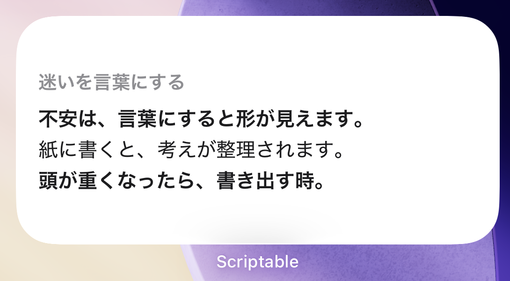
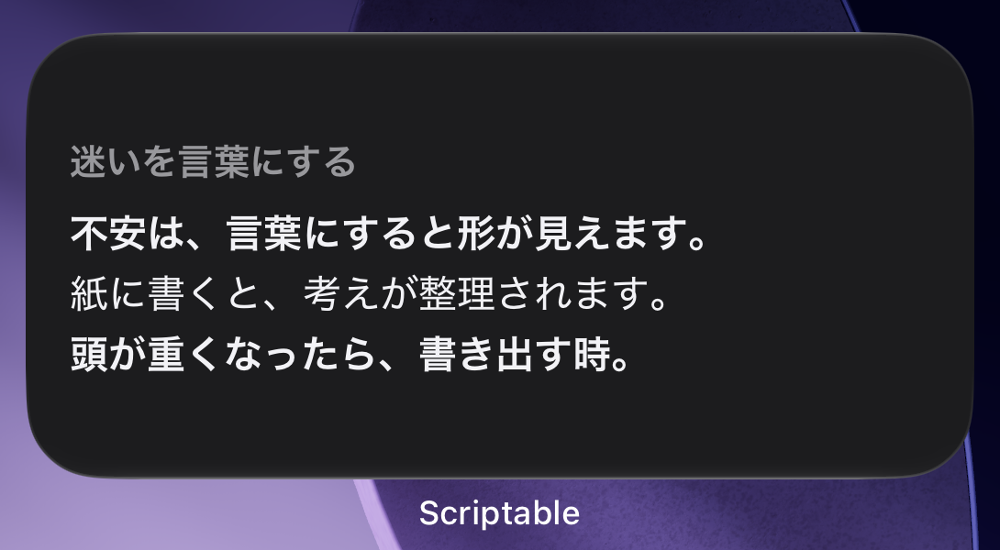

# kakugen-widget（格言ウィジェット）

Obsidian のボード（Kanban）から格言をランダムに選び、iPhone のホーム画面に表示するウィジェットです。
才能の言語化を毎日目に入れて、その考え方を自分の当たり前にすることが目的です。

## 1. 目的
- 自分で言語化した考え方を、毎日ホーム画面で目に入れて習慣にする。
- 格言は、Obsidian のボード上で取捨選択する。

## 2. しくみ
```
Obsidian（Kanban ボード）
  → iCloud Drive（Vault）
  → Scriptable（File Bookmarks から読む）
  → iPhone のウィジェット
```
- ボードの **「## Active」列のカードだけ** を読み、ランダムに1件を表示します。
- 「## Review」「## Done」「## Drop」の列は読みません。
- カードのチェック状態（`[ ]` / `[x]`）は無視します。
- 「::」を含む行（型・要確認など）は表示しません。

## 3. セットアップ
1. **Scriptable** をiPhoneに入れる。
2. **File Bookmarks** に、格言のボードがある Vault を登録する（名前は既定で「Obsidian」）。
3. ボードのファイルを用意する（形式は下記）。
4. `kakugen-widget.js` を Scriptable に入れる（ファイル名は `格言.js` など）。
5. Scriptable のフォルダに設定ファイル `kakugen-config.json` を置く（下記）。
6. ホーム画面に Scriptable のウィジェット（中サイズ）を追加し、設定で、入れたスクリプトを選ぶ。

### ボードの書き方
- フロントマターに `kanban-plugin: board` を入れる（Obsidian の Kanban プラグインが認識する形式）。
- 列は `## 列名`。このスクリプトが読むのは **既定で `## Active`** だけです。
- カードは `- [ ] 才能名` で始め、続きの行は2つの空白（またはタブ）でインデントする。
- 1行目が才能名、続く行が本文（2〜4行）です。`型::` などの行を入れてもよいです（表示されません）。
- 参考：`sample-board.md`（ダミーの格言）。

### 設定ファイル（kakugen-config.json）
個人の環境に合わせる値は、スクリプトではなく設定ファイルに書きます。
Scriptable のフォルダ（`iCloud Drive/Scriptable/`）に `kakugen-config.json` を置くと、初期値の上に値を上書きします。
見本は `kakugen-config.example.json` です。

```json
{
  "BOOKMARK": "Obsidian",
  "NOTE_PATH": "kakugen.md",
  "ICON_PATH": "icon.png",
  "ACTIVE_COLUMN": "Active",
  "REFRESH_MINUTES": 60
}
```

| 項目 | 意味 |
|---|---|
| `BOOKMARK` | File Bookmarks に登録した Vault の名前 |
| `NOTE_PATH` | Vault 内のボード（Markdown）のパス |
| `ICON_PATH` | Vault 内のアイコン画像のパス（任意） |
| `ACTIVE_COLUMN` | 表示する列の見出し名 |
| `REFRESH_MINUTES` | ウィジェットの更新間隔（分） |

- 設定ファイルがなければ、初期値で動きます。
- JSONの書式が壊れていると、ウィジェットに原因がわかるエラーが表示されます。
- アイコン画像は、各自で用意してください。画像がない場合は、アイコンなしで格言だけ表示します。

## 4. 工夫した点
- **設定とコードを分ける**：個人の環境に依存する値（ファイルの場所など）は、リポジトリに含めず、Scriptable のフォルダの設定ファイルに書く。
- **未ダウンロードのiCloudファイルへの対応**：読む前に `downloadFileFromiCloud` を実行し、そのあと存在を確認します。
- **Kanbanのインデントの混在への対応**：Kanban は、ドラッグ後にタブと空白でインデントを書くことがあります。行頭の空白をすべて捨てて判定します。
- **画像がないときの代替表示**：アイコンが読めなくても、格言は表示します。エラーにはしません。
- **行数に応じた文字サイズ**：4行は13pt、3行は15pt、2行は17pt。はみ出す場合は縮小して1行に収めます。
- **ライト／ダークモードの両対応**：色は `Color.dynamic` で切り替えます。

## 5. 作成について
Claude Code と協働して作成しました。

## 6. 注意
- このリポジトリには、格言の本文は含みません（`sample-board.md` はダミーです）。
- Scriptable の動作は、実機のiPhoneで確認してください。

## 7. スクリーンショット

<table>
  <tr>
    <td align="center"><br>ライトモード</td>
    <td align="center"><br>ダークモード</td>
  </tr>
</table>
